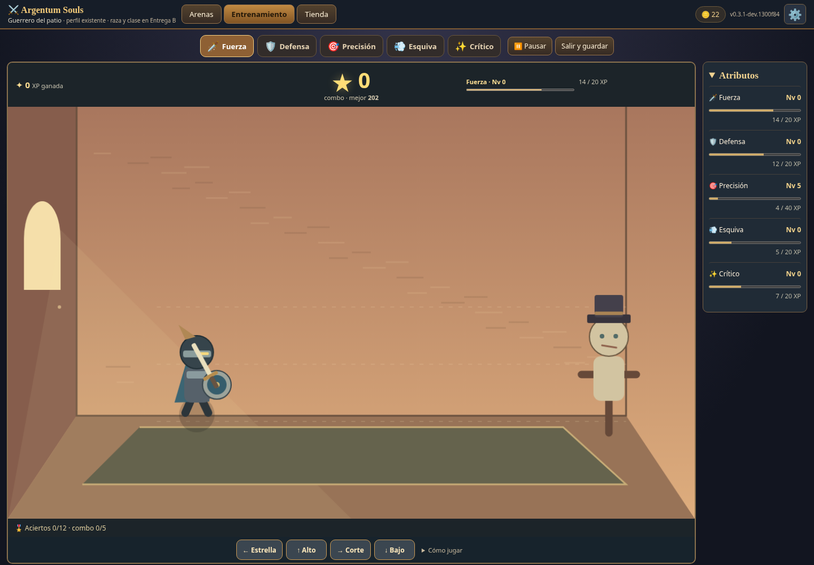
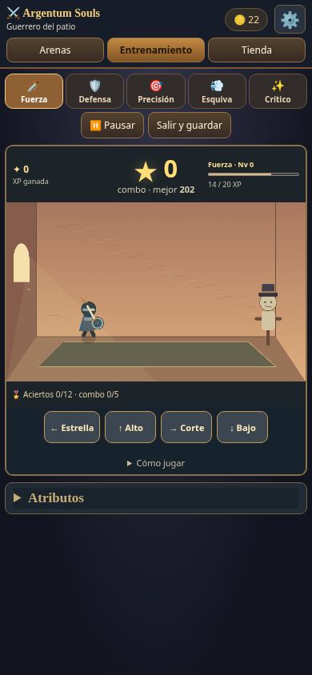

# Entrega A.1 — pulido de entrenamientos

Rama `dev/delivery-a1-training-polish`, creada desde `main` en `4007215`. Incluye la corrección pendiente del PR #3 (caché de CSS y grafo completo de módulos). No modifica arenas ni incorpora personajes; no publica ni fusiona automáticamente.

## Jugabilidad

- Dificultad por combo mediante `min(1, log(1+combo/40)/log(6))`. Crece desde los primeros aciertos, se suaviza y se limita en combo 200. Al fallar, recupera intensidad accesible en un máximo de 1,82 segundos; los objetos ya lanzados terminan su recorrido. La experiencia nunca se resta.
- Fuerza: velocidades y cadencias crecientes, lanzamientos curvos en tres alturas, ráfagas con repetición ocasional de altura para cortes múltiples y separación de llegadas en alturas diferentes. Los golpes al aire siguen siendo neutrales y no hay enfriamiento. Estrella distinta detrás del torso, x220–265/y433–445, con cartel de acción hacia atrás.
- Defensa: ocho sectores, manzanas completamente fuera del canvas 1200×720 al nacer, estela recta, viaje común de 1,9 a 1,4 segundos y ráfagas. Los impactos sucesivos se separan al menos 260 ms; no se generan bloqueos opuestos simultáneos.
- Precisión: blancos de radio 34–37 en escritorio y ajuste táctil; centro Perfecto dentro del 16% del radio, resto del blanco Bien, exterior Fallo. Movimiento leve alrededor de combo 10, intensidad y probabilidad de parejas continuas. No hay salto en combo 25. Los círculos se mantienen separados y dentro de la escena.
- Esquiva: dirección visible desde el primer instante, preparación, aviso Perfecto y ataque recto en 140 ms. Se acepta Bien desde el 20% de la anticipación, Perfecto entre 62% y 80%, y Bien hasta 80 ms después del inicio del golpe. La pose responde al pulsar; el resultado y la XP se confirman al ejecutar el ataque, una sola vez. Salir antes de esa confirmación descarta la reacción pendiente, sin quitar XP ya ganada. Los desplazamientos laterales dejan al héroe fuera del segmento que alcanza la estocada.
- Crítico: primera reacción de 820 a 740 ms, ventana aérea de 480 a 420 ms y Perfecto a los 75–200 ms del aviso aéreo. Leer correctamente un amague otorga un acierto y XP una sola vez. La variedad y la proporción de amagues aumentan; máximo tres consecutivos. Cada señal conserva su duración al aparecer. Anillo y estrella se iluminan en Perfecto, con avisos legibles también en móvil.

La configuración ajustable está en `src/training/balance.js`. [Tabla completa de parámetros y simulaciones](BALANCE_A1.md).

## XP y guardado

XP por acierto: `(Perfecto ? 3 : 2) + min(3, floor(combo/50)) + bonusDeHito`. Se conserva el añadido de la estación por acierto. Hitos 10/25/50/100/150/200: +3/+5/+8/+12/+16/+20 XP. La misión de 12 aciertos y mejor combo 5 otorga +12 XP y +15 monedas una vez por sesión; la estación no multiplica premios de misión.

Cada atributo conserva el mayor combo recompensado en el campo aditivo `comboRecords`. Se normaliza a cero para guardados anteriores, manteniendo niveles, XP, monedas, equipo, victorias y estaciones. Los hitos no se pueden repetir al romper combo, salir, cambiar de disciplina o recargar. La cadena larga también aumenta el premio ordinario: 200 aciertos Perfectos continuos dan más XP por acierto que reiniciar repetidamente en combo 10 o 12. La curva de niveles sigue siendo provisional; la calibración de Entrega B no se adelantó.

Se mantienen la clave propia de Souls, el bloqueo exclusivo entre pestañas, la recarga del estado al adquirir propiedad, la recuperación de cuota y el modo en memoria. El record se guarda junto a la XP en el mismo snapshot protegido. No se accede a guardados v7 de Idle. Un downgrade a una versión anterior que desconozca `comboRecords` podría perder solo ese registro adicional al volver a guardar; esta entrega no implementa compatibilidad de ida y vuelta con versiones anteriores.

## Interfaz

Combo con estrella grande centrado encima de la escena y mejor combo persistente secundario; animación en hitos, premios y misiones visibles. Controles y ayuda plegable dentro del marco; sin instrucciones duplicadas debajo. Panel derecho de 185 px con los cinco niveles, XP y barras, actualizado sin reconstruir sus nodos en cada acierto y con animaciones de subida de nivel. En pantallas pequeñas se coloca debajo y se puede plegar. Las señales son texto DOM legible, con tamaño independiente del escalado del canvas. Las animaciones decorativas respetan reducir movimiento y no bloquean controles.





## Validación reproducible

```sh
npm ci --ignore-scripts
npm run build
npm test
npm run test:balance
npm run test:browser
npm run test:mutation
```

- 40 pruebas unitarias: curva continua, límites, ráfagas y geometría, conservación de XP, hitos persistentes, misión y comparación contra reinicios intencionales, respuestas y poses reales.
- 43 comprobaciones Chromium: teclado/mouse/táctil, imágenes de objetos dibujados en sus coordenadas, trayectorias completas, ráfagas, Perfecto/Bien/Fallo, recompensas y recarga, animaciones de combo/nivel/cuerpo, escritorio/móvil y rutas bajo `/Argentum-Souls/`. Incluye las regresiones previas de concurrencia, cuota, getter de localStorage bloqueado, doble recompensa y caché de versiones anteriores.
- 35 simulaciones de 120 segundos, con combo fijado en 0/10/25/50/100/150/200 para cada modo. El solucionador usa entradas del motor y completó las secuencias sin fallos. El JSON con medidas está en `artifacts/balance-a1.json`; la tabla se regenera con `npm run test:balance`.
- Prueba de mutación: ignorar la pose en `hero()` debe hacer fallar tanto la prueba unitaria como la comprobación del cuerpo dibujado en Chromium. La prueba exige esos motivos concretos.

Los tests anteriores se adaptaron a los cambios explícitos de A.1: resultados de Esquiva al golpe, aciertos por ignorar amagues, parejas probabilísticas en vez de umbral 25, proyectiles que nacen fuera del canvas y el nuevo panel. No se retiraron las regresiones de guardado ni las comprobaciones del cuerpo dibujado.

La simulación demuestra límites y resolubilidad con un solucionador ideal; no certifica dificultad humana ni reemplaza tu prueba jugable. Táctil se prueba con eventos nativos Chromium/CDP, sin un teléfono físico. No se probó Safari/Firefox ni la URL pública desde este entorno. El PR aporta build Pages y ZIP servido por HTTP; la publicación requiere fusionar y desplegar posteriormente.
