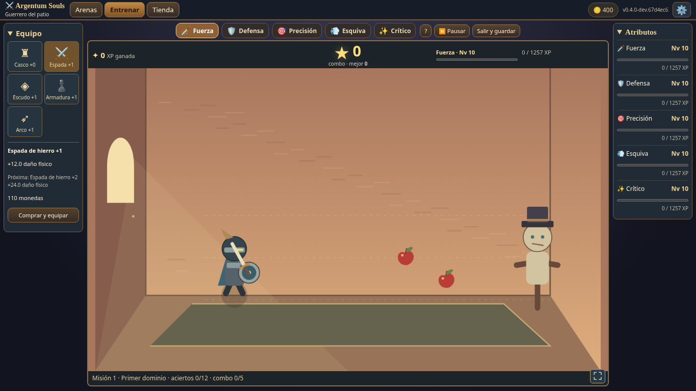
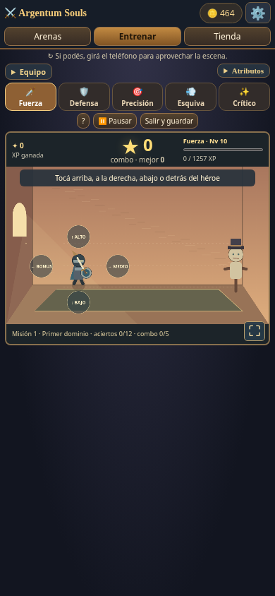
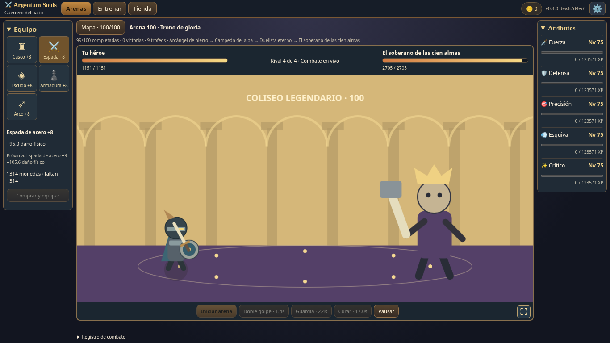
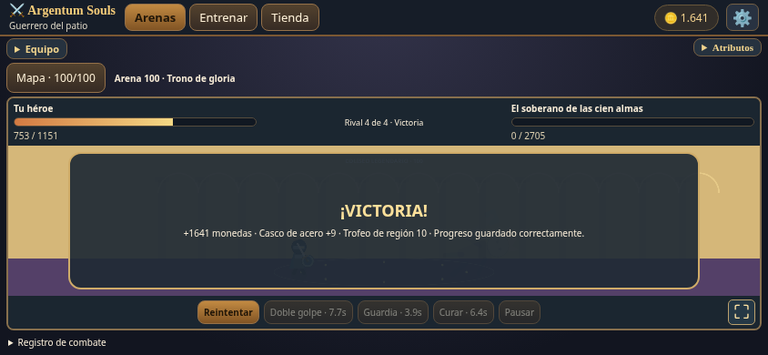

# A.3 + cien arenas jugables

Rama `dev/delivery-a3-hundred-arenas`, desde `main`/7db314e (A.2). Versión de código 0.4.0. El nuevo HTML raíz se genera con `npm run build`; la build de Pages está en `dist/`. No se fusiona ni publica automáticamente.

## Entrenamientos terminados en esta entrega

- Recuperación tras tres errores consecutivos: se detienen simulación y generación, se muestra «Presioná una tecla o tocá para continuar» y se consume esa acción para reanudar. Limpia objetos/ataques y deja 0,9 s de margen. No reinicia sesión, XP ni misiones; acertar reinicia el contador. Golpes al aire y estrellas opcionales siguen siendo neutrales.
- Misiones continuas por atributo: cinco plantillas (aciertos/combo, Perfectos, mecánica específica, cadena e híbrida), seguidas de rondas escalables. La misión 1 conserva +12 XP/+15 monedas. El premio y el avance de misión se aplican con el acierto en una sola transacción de guardado; cambiar de modo o recargar no vuelve a concederlo. El aviso dura dos segundos y durante ese tiempo ya cuenta la siguiente misión.
- Defensa usa un sector anular físico de radio 76, profundidad 21,4 y apertura 0,88 radianes: aproximadamente 7–8% mayor que el escudo recto anterior. La misma geometría dibuja y evalúa el contacto, incluida la prohibición de bloquear fruta pasada.
- Precisión aumenta el radio base de 48 a 54 (12,5%), manteniendo cercanos/medianos/lejanos, movimiento y colisión del mismo radio visible.
- Esquiva reconstruye preparación y ejecución de cabeza/torso, brazo/codo y rodilla/patada. Se eliminan los carteles de instrucciones y se conserva la ayuda voluntaria. Toda acción intentada se anima, aunque sea incorrecta; el daño y la reacción herida llegan después. Perfecto inicial pasa a 210 ms y baja suavemente a 160 ms, con una única función para círculo blanco y puntuación. Las tres evasiones y sus límites se prueban en canvas.
- Crítico conserva amague rojo, salto y golpe aéreo. Golpear en el resto de la fase válida da Bien y conserva combo. Perfecto se reduce a 80–180 ms; la primera reacción se acorta gradualmente, sin ventanas que se reduzcan indefinidamente.

[Medidas por combo y presupuestos de reacción](BALANCE_A3.md). Las recompensas por hitos persistentes se conservan.

## Pantalla, equipo y controles

Workspace de tres columnas: equipo, juego y atributos. La sala utiliza todo el ancho central y aproximadamente la misma altura de A.2. El canvas aumenta su mundo visible horizontalmente; los actores mantienen su escala y proporción, y el puntero invierte esa cámara. No se estira el dibujo ni se recorta el canvas para aparentar que entra. Se elimina el controlador inferior de botones y su código obsoleto.

Ambas escenas tienen ⛶. Se intenta Fullscreen API; si se rechaza, una clase de expansión visual ofrece la misma salida. La orientación horizontal se solicita solo desde ese gesto; su rechazo no bloquea el juego. Los listeners de la escena inactiva no desbloquean la orientación de la activa. En móvil hay sugerencia discreta de giro y paneles plegables; se verifican vertical, horizontal, redimensionamiento y coordenadas después de expandir/salir.

Inventario funcional de casco, espada, escudo, armadura y arco. Cada espacio compara calidad, estadísticas, precio y faltante. Comprar y equipar conserva niveles anteriores, descuenta una vez y actualiza el poder; una batalla conserva el daño recibido al aplicar una mejora, no se cura por volver a abrir el panel.

## Las cien arenas son combates completos

Diez regiones temáticas de diez arenas, cada una con paleta, fondo procedural, familias de enemigos y jefe de región. Exactamente cuatro enemigos consecutivos por arena; el cuarto es jefe y cada múltiplo de diez tiene nombre, tamaño, resistencia y presentación destacados. Las regiones incluyen patio, bosque, cavernas, pantano, desierto, hielo, ruinas, fortaleza, abismo y coliseo.

El nuevo `Combat` reemplaza el prototipo de 3/5 rivales: ambos personajes preparan, avanzan al contacto y vuelven, con retroceso, derrota y números flotantes. Los cuerpos no se cruzan al atacar simultáneamente. El daño se resuelve durante el contacto, con tiradas de acierto, evasión y crítico, guardias y curación activas. No se elige un vencedor por adelantado. Doble golpe prepara un impacto potenciado; Guardia tiene duración real; Curar respeta vida máxima y enfriamiento. Las recargas se ven en los botones.

Los rivales rápidos, blindados, brutos, místicos y duelistas cambian velocidad, evasión, armadura, daño o curación. Los jefes anuncian ataques cargados y aceleran al perder vida; un combate excesivamente prolongado aumenta su presión. Hay transición entre los cuatro, recuperación parcial de vida, victoria, derrota y reintento. Cambiar de sección o perder foco pausa el combate.

La primera victoria de cada arena entrega monedas y desbloquea la siguiente. Cada jefe de región mejora una pieza de equipo sin bajar la anterior y concede un trofeo; estos se derivan del mapa completado. Las repeticiones son práctica sin volver a cobrar el premio. No se entrega botín parcial al abandonar y no existe un impuesto por derrota. La dificultad depende del ID de arena y enemigo, nunca de `wins`.

## Progresión y compatibilidad

No hay nivel global ni tope de 100 en atributos. Fuerza aumenta daño, Defensa vida y mitigación, Precisión acierto, Esquiva evasión y Crítico probabilidad/multiplicador. Las probabilidades tienen límites y los aumentos usan rendimientos decrecientes. El equipo mantiene sus niveles numéricos y adquiere nombres de calidad; su potencia se suaviza después de 8.

Nueva XP requerida: `round(20 + 4L + 6L^2.3)`. No se convierten ni reducen niveles o XP anteriores. Los niveles bajos siguen siendo rápidos y el coste crece gradualmente. La proyección equilibrada de cinco atributos a 75, con 15 XP/s efectivos, ronda 255 horas de entrenamiento. No se exige nivel 100 para terminar las arenas, ni se usa un reloj real de seis meses para desbloquearlas.

[Balance de 100 arenas, perfiles, economía, probabilidades y tiempos](ARENA_BALANCE.md). La ruta de equipo puede ser bastante más rápida que la equilibrada: es un riesgo explícito del primer balance que necesita tus partidas, no se declara una economía definitiva.

Se conserva `argentum_souls_fiel_v2`, el escritor exclusivo y los estados de almacenamiento bloqueado, memoria y cuota. Se agregan `gear.helmet`, `missions` por atributo y `arena.completed` sin borrar monedas, XP, niveles, estaciones, equipo, victorias o récords. El historial `wins` del prototipo queda intacto; el nuevo mapa comienza en 1 porque antes no había IDs de cien arenas. Un guardado ilegible sigue protegido contra sobrescritura. `ArgentumSoulsBridge.exportProgress()` mantiene su esquema y copia de datos, con campos aditivos. No se toca Idle ni su v7.

## Verificación

Comandos mantenidos: `npm run build`, `npm test`, `npm run test:browser`, `npm run test:balance`, `npm run test:mutation`.

- 68 unitarias, incluidas migración, recuperación en cinco modos, misiones atómicas incluso con cuota, escudo curvo, acción equivocada visible, compras, habilidades, cuatro encuentros y premios idempotentes.
- 64 comprobaciones Chromium. Incluyen los regresores anteriores de teclado/mouse/táctil, caché, dos pestañas en ambos órdenes, cuota y getter de localStorage; además, misiones nativas consecutivas, derrota/reintento, arenas 1 y 100 jugadas con habilidades, cuatro muertes reales, cuerpos dibujados que avanzan, trofeo, premio con cuota y persistencia. La recuperación usa entradas nativas o amenazas colocadas en el borde de impacto, sin sustituir la evaluación del resultado.
- 60 escenarios de entrenamiento de 120 s, con perfiles instantáneo/restringido; 6000 combates de balance (100×5 perfiles×12 semillas), más 150 sondas de atributo único. La ruta completa 1–100 se resuelve con el motor real y cada premio se intenta cobrar de nuevo para verificar idempotencia.
- La prueba de mutación sigue rompiendo `hero()` en una copia temporal y exige fallos concretos de movimiento en unitarias y Chromium. La instrumentación descuenta la cámara horizontal: no puede confundir su desplazamiento con una pose animada.

Las pruebas anteriores se adaptaron a los cambios pedidos, sin retirar protección de guardados. El fin de la misión ahora se confirma en el payload del mismo acierto; los tests no esperan una segunda escritura. Las esperas de Esquiva se ajustaron al nuevo cierre de ventana y los escenarios de estrella/ráfaga aíslan amenazas para no interpretar una pausa de recuperación como un temporizador roto.

## Limpieza y límites reales

Se retiran el código/HTML de series de tres o cinco rivales, la fila de controles y sus manejadores, el trazo antiguo de Esquiva y reglas CSS del prototipo. Se conservan los informes históricos y las fixtures de caché porque documentan cambios y sostienen regresiones. Solo hay cuatro capturas actuales en esta entrega; no se genera ZIP.

Es una primera versión completa y jugable de las arenas, no una certificación final de balance. Los fondos y enemigos son vectoriales/procedurales, con familias reutilizadas por región; no son 400 ilustraciones únicas. Las probabilidades son muestras pequeñas y las horas dependen mucho de habilidad, estaciones y monedas. La política de simulación usa habilidades oportunamente y no representa una persona. Se revisaron imágenes y controles en Chromium de escritorio y emulación móvil, sin afirmar teléfono físico, Safari/Firefox ni bloqueo de orientación real en un dispositivo. Las batallas interrumpidas se reinician al recargar; el progreso ya ganado queda guardado. Personajes, razas y clases siguen pendientes y no se inventaron sus modificadores.
