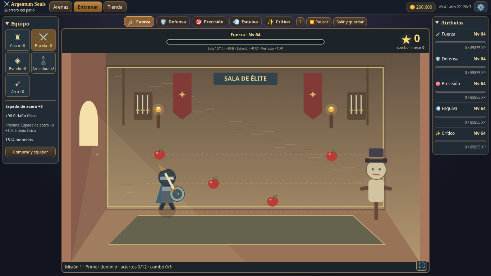

# Entrega A.3.1 — Combos, sala de entrenamiento y mejoras de combate

Base `main`/cbbb23d (A.3 fusionada). Rama `dev/delivery-a3-1-combos-room`. Build 0.4.1 compatible con rutas relativas de GitHub Pages; sin merge ni publicación automática. Los cuatro bocetos del usuario guían el HUD, el timing corporal, la sala progresiva y el selector de velocidad; se conservan gráficos vectoriales y audio propios.

## XP por acierto, sala y compatibilidad

Valores base iniciales exactos 2/4/12. Desde el cuarto acierto se suaviza la hipótesis cuadrática con el coste del nivel al iniciar la cadena, sin multiplicadores por tramos. El nivel de referencia no sube dentro de esa cadena; esto evita realimentación al ganar niveles. Cola lineal para que el premio siga creciendo incluso con niveles bajos. Perfecto suma 1 XP, estación suma su nivel, sala multiplica solo la base. Las misiones conservan sus premios aparte, incluidos en el mismo guardado atómico. Los hitos antiguos mantienen el récord/animación, sin otra entrega de XP que duplique la nueva curva.

El amague rojo concede 1 XP fijo: no incrementa combo, no usa sala/estación y no limpia fallos activos consecutivos. Sigue contando como lectura para las misiones. Tres señales activas perdidas llevan a recuperación aunque haya amagues entre ellas. Los objetos resueltos no vuelven a conceder premio por pausar, cambiar sección o recargar.

Sala general de diez niveles, +0% a +90%, precio `round(180×nivel^2.15)` para la siguiente mejora. La compra muestra coste/faltante y se bloquea por falta de monedas o escritor. Escenarios 1/3/5/7/10 agregan paredes, soportes, armas, estandartes, luces y emblema; mantienen la geometría jugable. Las estaciones y el equipo anterior no se eliminan ni convierten.

[630 simulaciones de XP, extremos, costes y razones de la fórmula](BALANCE_A31_XP.md). Un combo 50 en nivel 64 y sala 10 da unas 73.000 XP activas antes de Perfectos/estaciones/misiones, frente a 85.855 del siguiente nivel. En nivel 100, unas 77.000 frente a 239.284. No se afirma conservar las ~255 h históricas de A.3: esta recompensa cambia deliberadamente el ritmo y los combos altos necesitan calibración humana. En niveles iniciales una cadena muy buena sigue permitiendo varias subidas; las simulaciones muestran los valores completos y no los ocultan.

La migración solo agrega `room`, por defecto 1 y limitado a 10. Se mantienen clave, niveles, XP, monedas, equipo, estaciones, récords, misiones, victorias y arenas completadas. `save-session.js` permanece intacto; se conserva exclusión entre pestañas, cuota/reintento y modo memoria. El Bridge exporta el campo aditivo; no se toca Idle v7.

## HUD y subidas de nivel

Barra central, nombre/nivel encima y combo a la derecha. El total de XP de sesión se retira del HUD visible; sigue en el resumen de salida y los números detallados están en el panel de atributos. Un relleno visual animado acompaña el progreso accesible. Al subir nivel, la barra llega al borde y vuelve al sobrante; un aviso breve muestra ícono grande, nivel y mejora real calculada comparando `heroStats` antes/después. Por ejemplo, acierto se expresa en puntos porcentuales reales, sin anunciar un +3% ficticio. Varias subidas se agrupan en un aviso, no bloquean la simulación ni capturan entradas. El sonido de recompensa respeta el interruptor y la animación respeta movimiento reducido.

## Esquiva justa

Antes, la extensión máxima ocurría dentro de la ventana blanca. Ahora la preparación retira claramente cabeza/torso, brazo/codo o pierna/rodilla. El muñeco mantiene esa pose durante el blanco y extiende después. La ventana blanca conserva 210–160 ms según combo y termina 200 ms antes del contacto. Bien se acepta hasta 35 ms antes del contacto; la puntuación se confirma al impacto, con la misma función temporal para todos los ataques. La acción incorrecta también se mueve primero y recibe daño después. No se añaden carteles direccionales grandes.

[Tabla de ventanas y 60 simulaciones de entrenamiento](BALANCE_A31_TRAINING.md). Los presupuestos se expresan con relación al contacto, no se presenta el avance de un reloj como una prueba humana de reflejos.

## Combate ×1/×2 y cuatro rivales

×1 alarga preparación, aproximación, barrido, impacto y retorno. Se mueven espada, brazo rival y zancadas, con retroceso del golpeado; los ataques especiales tienen presentación propia. El contacto se aplica al terminar la aproximación, momento en que el movimiento alcanza su máximo. Preparación heroica 360 ms, normal enemiga 420 ms, cargada 900 ms; aproximación 260 ms y retorno 340 ms. Todas se centralizan en `COMBAT`, también el intervalo y la transición de 1,1 s.

×2 ejecuta dos veces los mismos pasos de 1/120 s por segundo real. No pasa un dt gigante a la física ni divide solo las animaciones. Vida, RNG, cooldowns, guardias y transiciones coinciden a igual tiempo simulado y secuencia de habilidades. Cambiar de velocidad durante pausa no avanza el combate. La velocidad es una preferencia de la sesión, no un campo de progreso nuevo.

Los cuatro rivales tienen HP y presión sostenida estrictamente crecientes incluso si cambia el arquetipo. El tercero tiene al menos 1,6 veces el HP del primero; el jefe conserva ataques cargados y mayor peso, sin concentrar todo el encuentro. Se mantienen cien arenas, regiones, habilidades activas, premios únicos, derrota/reintento y cuatro enemigos reales. [6000 combates, 150 sondas y duración por rival](ARENA_BALANCE.md). Los tiempos son simulados en ×1; ×2 reduce el tiempo real, no el simulado.

## Futuro y límites

[Propuesta de nivel general, talentos, clases/razas y economía con pesca](FUTURE_PROGRESSION_AND_FISHING.md). Es documentación: no se agregan puntos de atributos, clases, razas, cuentas ni integración del HTML de pesca. Los IDs/modificadores de Idle requieren revisión explícita antes de implementar. La economía compartida propone una cartera del anfitrión con operaciones idempotentes y migración revisable, no dos copias de oro.

Verificación local final aprobada: los cinco comandos existentes, 81 unitarias y 72 comprobaciones Chromium, incluyendo las regresiones anteriores y ocho nuevas comprobaciones A.3.1. Las capturas son reales del navegador y los controles usan teclado, clic y toque nativos. Se verifican móvil vertical/horizontal y anchuras 900/1024. No se afirma teléfono físico, Safari/Firefox, prueba humana prolongada ni balance definitivo. Los bocetos no se presentan como capturas del juego implementado. Los resultados finales de ejecución se registran en WORKLOG y el PR.
